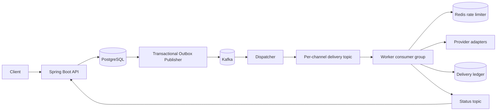

# Distributed Notification Platform

Production-style event-driven notification infrastructure built with **Java 21, Spring Boot, Kafka, PostgreSQL, Redis, Docker, Kubernetes, and GitHub Actions**.

It accepts a notification once, persists it durably, asynchronously fans it out to EMAIL/SMS/PUSH/IN_APP channels, retries transient failures, rate-limits delivery, deduplicates Kafka redeliveries, exposes status, and routes exhausted failures to a dead-letter topic.

> The repository deliberately uses local logging provider adapters instead of pretending to send real email/SMS/push without credentials. The orchestration, persistence, retry, rate limiting, idempotency, and deployment paths are fully implemented; provider adapters are the replaceable boundary.

## Architecture



Detailed design: [`docs/ARCHITECTURE.md`](docs/ARCHITECTURE.md)  
Tradeoffs/failure handling: [`docs/TRADEOFFS.md`](docs/TRADEOFFS.md)  
Benchmark methodology: [`docs/BENCHMARKING.md`](docs/BENCHMARKING.md)  
Interview walkthrough: [`docs/INTERVIEW_GUIDE.md`](docs/INTERVIEW_GUIDE.md)

## Features

- Transactional outbox to avoid DB/Kafka dual-write loss
- Scheduled notifications through outbox `available_at`
- Request idempotency via `Idempotency-Key`
- Kafka consumer-group horizontal scaling (6 delivery consumers / 3 dispatchers in the local portfolio profile)
- Per-channel fan-out and independent retries
- Exponential retry topics + dead-letter topic
- Durable per-channel delivery ledger
- Redis atomic Lua fixed-window rate limiter
- PostgreSQL/Flyway migrations
- Health/readiness/liveness + Prometheus actuator endpoint
- Docker multi-stage builds
- Docker Compose local environment
- Kubernetes manifests for app/worker replicas
- GitHub Actions build/test/container CI
- OpenAPI contract
- Unit tests

## Run locally

Requirements: Docker + Docker Compose.

```bash
docker compose up --build
```

API: `http://localhost:8080`  
Worker health: `http://localhost:8081/actuator/health`  
API health: `http://localhost:8080/actuator/health`  
Prometheus: `http://localhost:8080/actuator/prometheus`  
PostgreSQL host port: `localhost:5433` (container port remains `5432`)

> This repository is intentionally backend/infrastructure focused and does not include a custom browser UI. The API can be exercised with the included smoke/load scripts or any REST client.

### Create a notification

```bash
curl -i -X POST http://localhost:8080/api/v1/notifications \
  -H 'Content-Type: application/json' \
  -H 'Idempotency-Key: demo-001' \
  -d '{
    "recipient": "nitchaya@example.com",
    "subject": "Your order shipped",
    "body": "Order #UF-2027 is on the way.",
    "channels": ["EMAIL", "PUSH"],
    "metadata": {"orderId": "UF-2027"}
  }'
```

The API returns `202 Accepted` and a notification UUID.

```bash
curl http://localhost:8080/api/v1/notifications/<UUID>
```

Status moves through `QUEUED -> PROCESSING -> SENT` (or `FAILED`).

### Scheduled notification

Use an ISO-8601 UTC timestamp:

```json
{
  "recipient": "nitchaya@example.com",
  "subject": "Reminder",
  "body": "Interview in 30 minutes",
  "channels": ["EMAIL"],
  "scheduledAt": "2027-02-15T14:00:00Z"
}
```

### Demo the retry + DLT path

The local provider adapters intentionally fail recipients containing the word `fail`:

```bash
curl -X POST http://localhost:8080/api/v1/notifications \
  -H 'Content-Type: application/json' \
  -d '{"recipient":"fail@example.com","body":"DLT demo","channels":["EMAIL"]}'
```

This is only a deterministic local test hook. Replace the provider adapter with a real provider in production.

## Measure it before adding performance metrics to your resume

After the stack is healthy:

```bash
python3 scripts/load-test.py --count 200 --concurrency 20
```

The script reports client-side HTTP acceptance latency/throughput and server-timestamped notification lifecycle latency. It monitors all accepted notifications fairly with per-notification deadlines, so a queued polling thread cannot create fake long-tail E2E latency. See [`docs/BENCHMARKING.md`](docs/BENCHMARKING.md).

Before benchmarking, verify correctness:

```bash
./scripts/smoke-test.sh
```

The smoke test polls until `SENT`/`FAILED` instead of relying on a fixed sleep.

## Build without Docker

```bash
mvn clean verify
```

Run infrastructure separately, then:

```bash
mvn -pl notification-api -am spring-boot:run
mvn -pl notification-worker -am spring-boot:run
```

## Production deployment

The Kubernetes manifests assume managed PostgreSQL, Kafka and Redis. Replace placeholders under `deploy/k8s/config.yaml`, publish the two images to your registry, then:

```bash
kubectl apply -f deploy/k8s/namespace.yaml
kubectl apply -f deploy/k8s/config.yaml
kubectl apply -f deploy/k8s/api.yaml
kubectl apply -f deploy/k8s/worker.yaml
```

For AWS, a sensible mapping is API/worker on EKS or ECS, MSK for Kafka, RDS PostgreSQL, ElastiCache Redis, and CloudWatch/OpenTelemetry for observability.

## Reliability semantics

This project intentionally claims **at-least-once**, not magical global exactly-once delivery. Kafka retries can redeliver, while external providers sit outside Kafka transactions. The durable `(notification_id, channel)` ledger makes broker redeliveries idempotent; production provider adapters should also pass the same key to vendors that support idempotency.

## Repository structure

```text
notification-common/    shared event contracts
notification-api/       REST API, notification state, transactional outbox
notification-worker/    dispatcher, delivery consumers, retries, rate limits, providers
scripts/                smoke/load helpers
docs/                   architecture, tradeoffs, interview notes, OpenAPI
deploy/k8s/             Kubernetes deployment manifests
```

## Resume-safe metrics

Do **not** invent throughput/latency numbers. Run the corrected `scripts/load-test.py` on your own machine and report only the measurements from that exact workload and environment. Architecture facts you can safely claim immediately include 12 delivery partitions, 6 concurrent delivery consumers, 6 requested partitions, 3 concurrent dispatchers, 3 status partitions/consumers, four supported channels, and horizontally scalable consumer groups.
