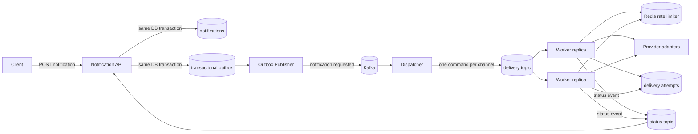

# Architecture

## System flow

## Delivery semantics

The system deliberately targets **at-least-once delivery**. Kafka can redeliver after consumer failures, so each `(notification_id, channel)` has a database uniqueness constraint and workers short-circuit already-sent deliveries. This makes duplicate Kafka records safe while avoiding an unrealistic claim of end-to-end exactly-once delivery to external providers.

## Why a transactional outbox?

Writing the notification and publishing directly to Kafka creates a dual-write failure: the database commit can succeed while Kafka publish fails (or vice versa). The API writes the notification plus an outbox row in one PostgreSQL transaction. A poller publishes pending rows and marks them published only after broker acknowledgement.

## Why fan out before provider delivery?

A multi-channel notification is converted to one command per channel. EMAIL can retry independently from SMS or PUSH, and slow/failing providers do not block successful channels. It also makes horizontal scaling natural because Kafka partitions distribute independent delivery commands across worker replicas.

## Retry / DLT

The worker uses Spring Kafka non-blocking retry topics with exponential backoff (1s, 2s, 4s; 4 total attempts) and a dead-letter topic after attempts are exhausted. Spring Kafka documents that retry-topic based processing trades away strict topic ordering; that is acceptable here because delivery commands are independently idempotent.

## Scaling model

- API: stateless HTTP replicas behind a load balancer.
- Outbox: `FOR UPDATE SKIP LOCKED` lets multiple API replicas poll without publishing the same row concurrently.
- Dispatcher: 6 request partitions with local listener concurrency `3`; additional replicas can scale the same consumer group up to the partition count.
- Delivery: 12 delivery partitions with local listener concurrency `6`; additional worker replicas can consume in parallel, with useful active concurrency capped by the partition count.
- Status projection: 3 status partitions with listener concurrency `3` so independent notification status streams can update concurrently.
- Redis: shared fixed-window rate limiting.
- PostgreSQL: source of truth for notification and delivery state.

## Provider abstraction

`DeliveryProvider` isolates channel-specific integrations. The repository ships with deterministic logging adapters so the project runs without paid credentials. Replace these classes with adapters for SES/SendGrid, SNS/Twilio, FCM/APNs, or an internal in-app store without changing the orchestration layer.
